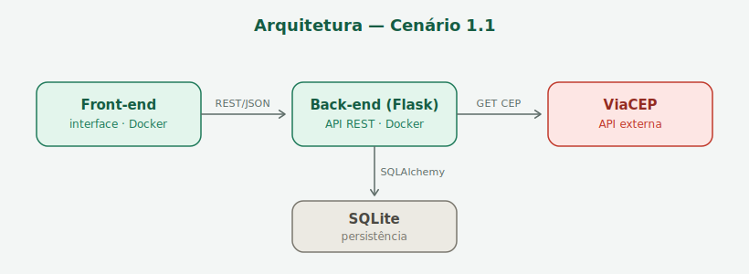

# Carteira de Vacinação Digital — Interface (Front-end)

Interface web (HTML, CSS e JavaScript puro) para acompanhar a carteira de
vacinação do calendário nacional (0 a 4 anos). O usuário se cadastra, registra
as doses aplicadas e visualiza o status de cada vacina (**Em dia**, **Atrasada**
ou **Futura**), além de um relatório de cobertura por cidade.

Este é o **componente principal** do MVP no **Cenário 1.1**: a interface consome
apenas a API (back-end), que por sua vez consome o serviço externo **ViaCEP**.

## Arquitetura da aplicação



O front-end conversa **somente** com o back-end, por REST/JSON, usando os quatro
métodos HTTP. Quem consome a API externa (ViaCEP) é o back-end — assim os dados
externos são tratados no servidor, sem redirecionamento.

### Rotas consumidas (os 4 métodos)

| Ação na interface           | Método | Rota da API             |
|-----------------------------|--------|-------------------------|
| Cadastrar usuário           | POST   | `/usuario`              |
| Abrir/atualizar a carteira  | GET    | `/doses?cpf=`           |
| Editar cadastro             | PUT    | `/usuario?cpf=`         |
| Remover uma dose            | DELETE | `/dose?id=`             |

## API externa — ViaCEP

- Serviço: ViaCEP (https://viacep.com.br) — gratuito, público, sem cadastro/chave.
- Rota: `GET https://viacep.com.br/ws/{cep}/json/`
- O consumo é feito **no back-end**; a interface apenas informa o CEP no cadastro.

## Como rodar localmente

A interface é estática. Basta servir a pasta. Com Python:

```bash
python -m http.server 8080
```

Depois abra `http://localhost:8080` no navegador.

> A API precisa estar rodando em `http://127.0.0.1:5000` (ver o repositório do
> back-end). O endereço da API está em `app.js`, na constante `API`.

## Como rodar com Docker

```bash
docker build -t carteira-front .
docker run -p 8080:8080 carteira-front
```

## Rodar tudo junto (opcional, docker compose)

O arquivo `docker-compose.yml` sobe front-end e back-end juntos. Requer os dois
repositórios clonados lado a lado (`./front-end` e `../back-end`):

```bash
docker compose up --build
```

## Estrutura

```
front-end/
├── index.html
├── app.js                 # chamadas à API (GET, POST, PUT, DELETE)
├── style.css
├── docs/arquitetura.png   # fluxograma da arquitetura
├── Dockerfile
└── docker-compose.yml     # opcional (sobe front + back)
```
